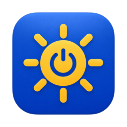
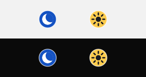
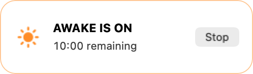
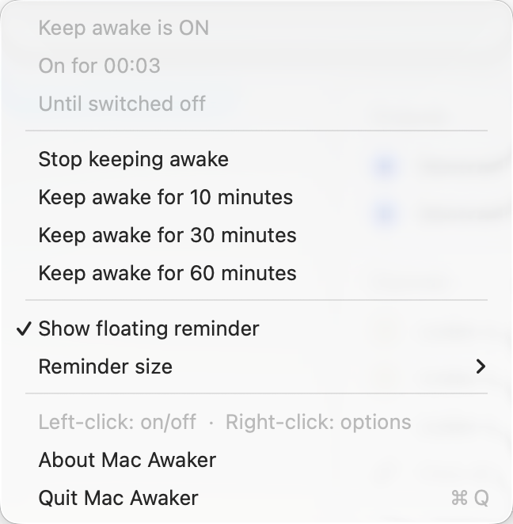

  

<h1 align="center">Mac Awaker</h1>

<strong>Keep your Mac awake when you need it.</strong>

  <a href="https://github.com/rg4sun/mac-awaker/releases/latest/download/Mac-Awaker.zip"><strong>Download for Mac</strong></a>
  · macOS 13 or later · Apple silicon and Intel

Reading a long article, following a recipe or keeping an eye on a dashboard?
Click the little moon in your menu bar. Mac Awaker keeps your display on until
you stop it or your timer runs out.

  

- **One click to stay awake.** The moon turns into a sun, so you can tell at a glance that your display is staying on.
- **Give it a time limit.** Pick 10, 30 or 60 minutes, or keep it on until you switch it off.
- **See the timer where you want it.** Use a small movable circle, keep the full reminder, or hide it altogether.
- **Keep your usual sleep settings.** When the session ends, your Mac goes back to its normal behaviour. You can still lock it manually.

## A small reminder, when you want one

<table>
  <tr>
    <th>Compact circle</th>
    <th>Standard reminder</th>
  </tr>
  <tr>
    <td align="center"></td>
    <td align="center"></td>
  </tr>
</table>

Drag either reminder out of the way. Click the sun on the circle or **Stop** on
the standard reminder when you're done.

## Right-click for more

See how long your Mac has been awake, start a timed session or change the
reminder size. The menu bar icon stays small either way.

  

## Get started

1. [Download Mac Awaker](https://github.com/rg4sun/mac-awaker/releases/latest/download/Mac-Awaker.zip), then unzip it.
2. Move **Mac Awaker.app** to **Applications** and open it.
3. Click the blue moon to start. Click the sun to stop, or right-click it for options.

No account or internet connection needed to use the app.

If macOS asks you to approve the app on first launch, see
[Apple's guide to opening downloaded apps](https://support.apple.com/en-ie/102445).
This download hasn't been notarised by Apple.

[Report a problem or suggest an idea](https://github.com/rg4sun/mac-awaker/issues) · [Build from source](docs/BUILDING.md)
